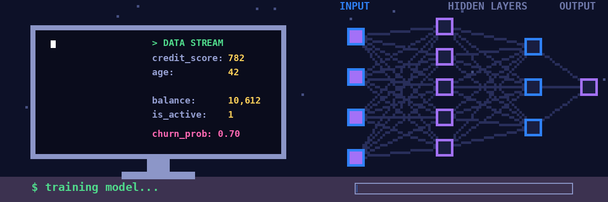

<!-- Save this as README.md in a repo named exactly: TheR0HIT/TheR0HIT (public) -->

  

<h1 align="center">Hi, I'm Rohit Raj 👋</h1>
Passionate about Machine Learning, Deep Learning, and LLMs. I learn by building and deploying real projects, and I'm aiming for an AI/LLM Engineer role.

  

---

## 🧑‍💻 About Me

  

I'm a second-year B.Tech Computer Science student , working toward an **AI / LLM Engineer** role.
I learn by building: every concept I study ends up as a project, and every project gets deployed so it can be used, not just read.

- 🔭 Currently building **rag-tutor-bot**, a versioned RAG system (v1.0 → v1.4) with an evaluation harness to benchmark every improvement
- 🧠 Studied: ML fundamentals, neural networks, NLP and Transformers, LLM APIs, RAG, QLoRA fine-tuning
- 🧩 Practicing DSA on Striver's A2Z sheet, focusing on pattern-based problem solving
- 🎯 Goal: ship visible, deployed AI projects with measurable results

---

## 🛠️ Skills & Technologies

### Languages

### Machine Learning & Deep Learning

### LLMs, NLP & RAG

### Deployment & Tools

---

## 🚀 Featured Projects

| Project | What it does | Stack | Links |
|---|---|---|---|
| **[ANN Customer Churn Prediction](https://github.com/TheR0HIT/ANN-Classification-Churn)** | Neural network that predicts whether a bank customer will leave, served through an interactive app | Keras, TensorFlow, Scikit-learn, Streamlit | [Code](https://github.com/TheR0HIT/ANN-Classification-Churn) · [Live Demo](https://ann-classification-churn-aax8aqdqr6lnsdm3kbkwuy.streamlit.app/) |
| **rag-tutor-bot** *(in progress)* | Versioned RAG system (v1.0 → v1.4) with conversation memory and an evaluation harness | LangChain, ChromaDB, HuggingFace Embeddings, Gemini | [Code](https://github.com/TheR0HIT/rag-tutor-bot) |
| **[House Price Prediction](https://github.com/TheR0HIT/house-price-prediction)** | Predicts house prices across 6 Indian cities | Random Forest, Pandas, Scikit-learn | [Code](https://github.com/TheR0HIT/house-price-prediction) |
| **[Netflix EDA](https://github.com/TheR0HIT/netflix-eda)** | Exploratory data analysis on Netflix movies and TV shows | Pandas, Matplotlib, Seaborn | [Code](https://github.com/TheR0HIT/netflix-eda) |
| **[DSA Practice](https://github.com/TheR0HIT/DSA_practice)** | Pattern-based problem solving: two pointers, sliding window, binary search, prefix sum, hashing | Python | [Code](https://github.com/TheR0HIT/DSA_practice) |

---

## 🗺️ Learning Roadmap

- [x] Python, Git, ML fundamentals (NumPy, Pandas, Scikit-learn)
- [x] Neural networks and deep learning (Keras)
- [x] NLP and Transformers (BERT fine-tuning)
- [x] LLM APIs, prompt engineering, RAG with LangChain
- [x] QLoRA fine-tuning concepts (PEFT, SFTTrainer)
- [ ] rag-tutor-bot v1.0 → v1.4 with benchmark table
- [ ] Agents and tool use
- [ ] MLOps: Docker, CI/CD, experiment tracking
- [ ] LLM fine-tuning project with published results

---

## 📊 GitHub Stats

  
  

---

## 📫 Connect With Me

  
  
  

<i>Building in public, one deployed project at a time.</i>

